<div align="center">

# 🪐 OpsPulse

### Mission control for incidents. A complete journey from commit to cluster.

**Observe. Respond. Stay ahead.**

[](https://github.com/Chhavi07-arch/OpsPulse-devops-platform/actions/workflows/ci-cd.yml)


[Explore the app](#-a-tour-of-mission-control) · [Run it](#-launch-locally) · [Architecture](#-how-the-platform-fits-together) · [Verified results](#-evidence-and-project-status)

**Chhavi Ahlawat · 24BCS10201 · Session 21 — Final DevOps Project**

</div>

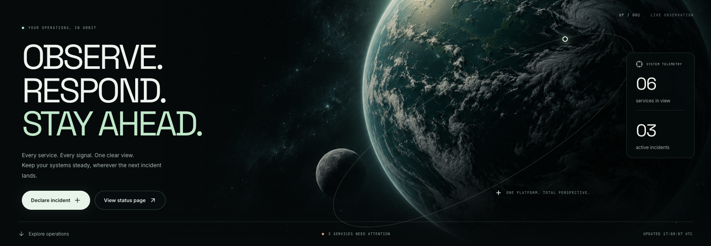

> **The mission:** give an on-call team one place to understand service health, coordinate an incident, and keep users informed—then deliver that application through a tested, security-gated Kubernetes workflow.

OpsPulse combines a real **React + FastAPI incident-management application** with the platform around it: Docker, Helm, GitHub Actions, security scanning, Argo CD, Prometheus/Grafana and Terraform for an AWS EKS demo. The dark orbital theme pairs a mint-green accent with an Earth backdrop, while the workflows remain practical and readable.

**Reading guide:** this page is the illustrated project tour. The [operations guide](docs/operations-guide.md) contains the detailed setup commands, recovery steps and teardown procedures.

## ✨ At a glance

| Product | Delivery platform | Verified evidence |
|---|---|---|
| Incident lifecycle and response timeline | Multi-stage, non-root Docker images | **30 backend tests passed** |
| Service catalogue and health summaries | Helm deployment and in-cluster smoke tests | **97% backend coverage** |
| Public status page and uptime history | Parallel SAST, SCA, secrets and IaC gates | **10 CI jobs passed** |
| Responsive desktop/mobile, dark/light themes | SHA-tagged images and Argo CD GitOps | Successful CI deployment to **kind** |
| MTTR, severity mix and incident trends | Prometheus metrics, Grafana dashboard and alerts | AWS Terraform **plan verified; not deployed** |

Numbers above come from [CI run 38599535048](https://github.com/Chhavi07-arch/OpsPulse-devops-platform/actions/runs/38599535048), for commit `fa87670`, on 14 October 2026. Coverage describes the backend test suite, not the frontend or infrastructure.

<details>
<summary><strong>🧭 Navigate this README</strong></summary>

- [A tour of mission control](#-a-tour-of-mission-control)
- [How the platform fits together](#-how-the-platform-fits-together)
- [From a commit to a deployment](#-from-a-commit-to-a-deployment)
- [Security at every layer](#-security-at-every-layer)
- [Kubernetes, storage and resilience](#-kubernetes-storage-and-resilience)
- [Observability and GitOps](#-observability-and-gitops)
- [AWS demo design](#-aws-demo-designed-and-ready-to-launch-later)
- [Launch locally](#-launch-locally)
- [API and data model](#-api-and-data-model)
- [Repository map](#-repository-map)
- [Evidence and project status](#-evidence-and-project-status)
- [Lessons and next steps](#-lessons-and-next-steps)

</details>

## 🌍 A tour of mission control

The screenshots below are captured from the running local application with an isolated **SQLite demo database**. They show real UI/API behaviour with seeded example incidents; they are not evidence of a live AWS deployment. Container and Kubernetes deployments use **PostgreSQL**.

### 01 · See the state of operations

The overview brings together active incidents, mean time to resolve, operational services, the last 14 days of incident activity, and the current severity mix. Service health is **derived from incident records**; OpsPulse does not independently probe the external services represented in the demo.

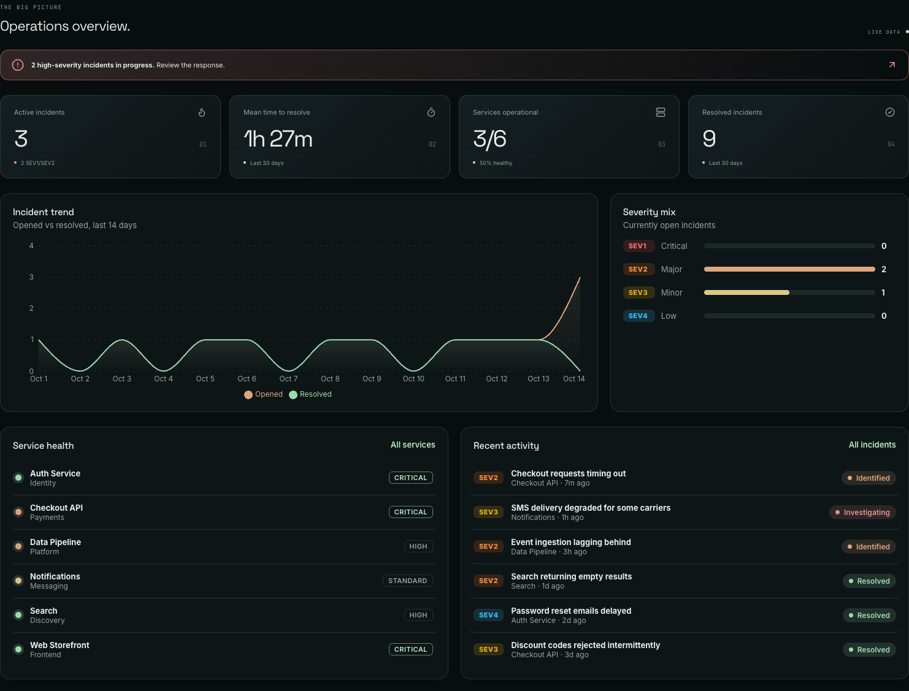

### 02 · Declare an incident with context

Choose the affected service, assign severity from **SEV1 to SEV4**, name an incident commander and describe the impact. The declaration becomes the first entry in the incident timeline.

<p align="center">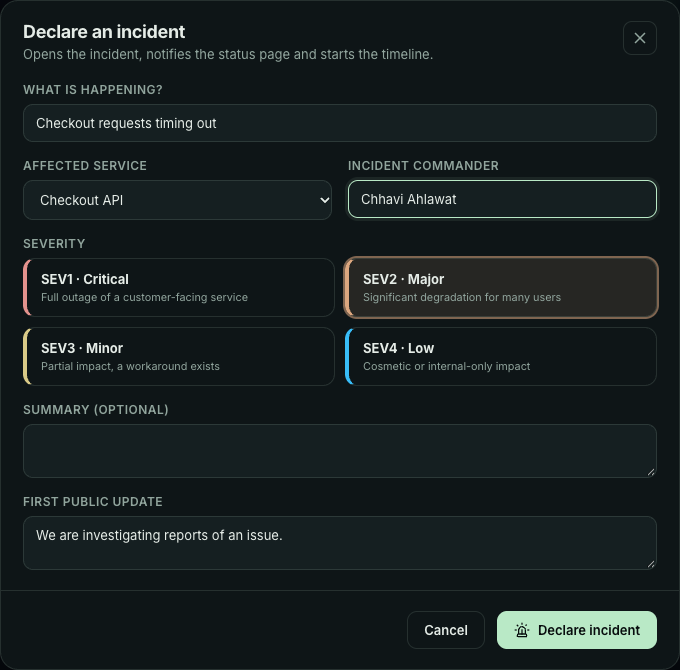</p>

### 03 · Keep the response moving

**Investigating → Identified → Monitoring → Resolved** gives the response a clear progression. Each update records its message, author and timestamp. Teams can change severity, add notes, resolve an incident or reopen it when necessary.

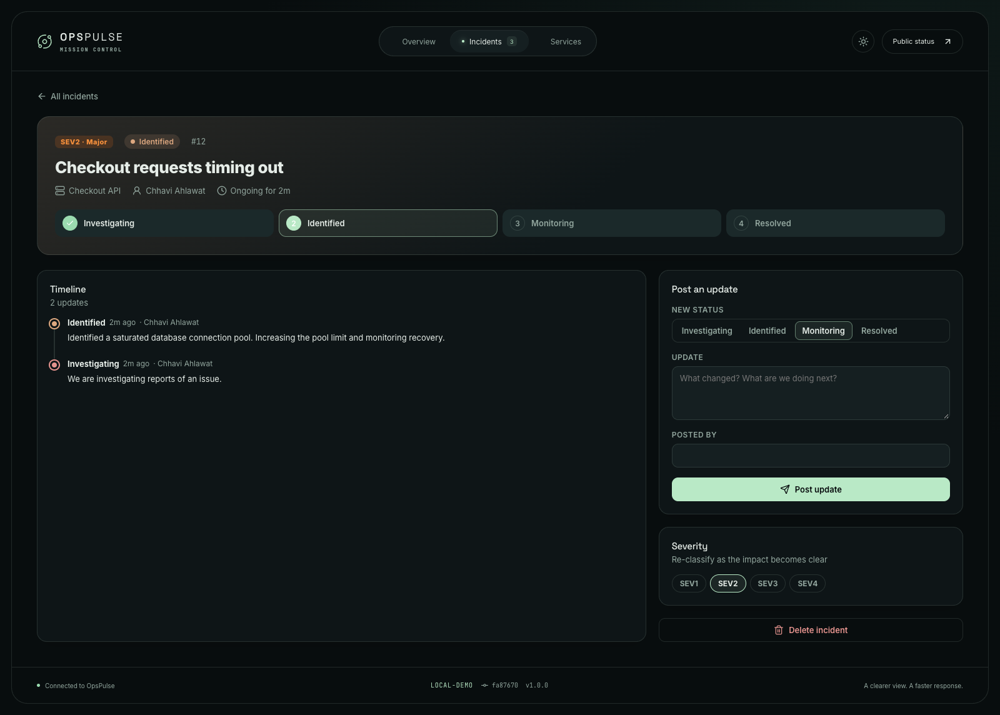

### 04 · Find the incidents that matter

Search by text and filter by lifecycle status, severity or service. The incident table puts ownership, impact and elapsed time beside each record.

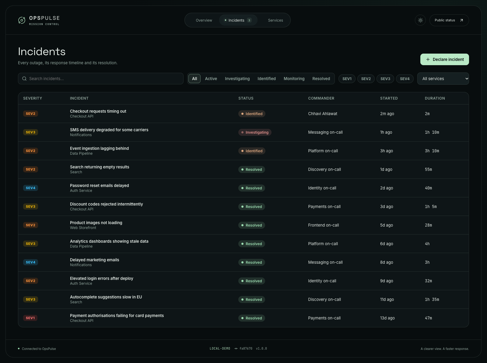

### 05 · Know what you operate

The service catalogue records each service’s team, criticality and description. Health and active-incident counts connect the catalogue to the response workflow. A service with incident history cannot simply be deleted, preserving those relationships.

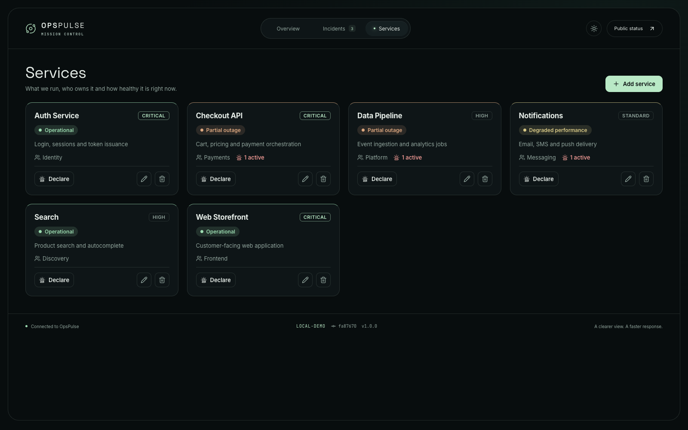

### 06 · Keep users informed

The public status page presents current impact, response updates, recent resolutions and **30-day uptime history**. Uptime calculations merge overlapping outage intervals so the same downtime is not counted twice.

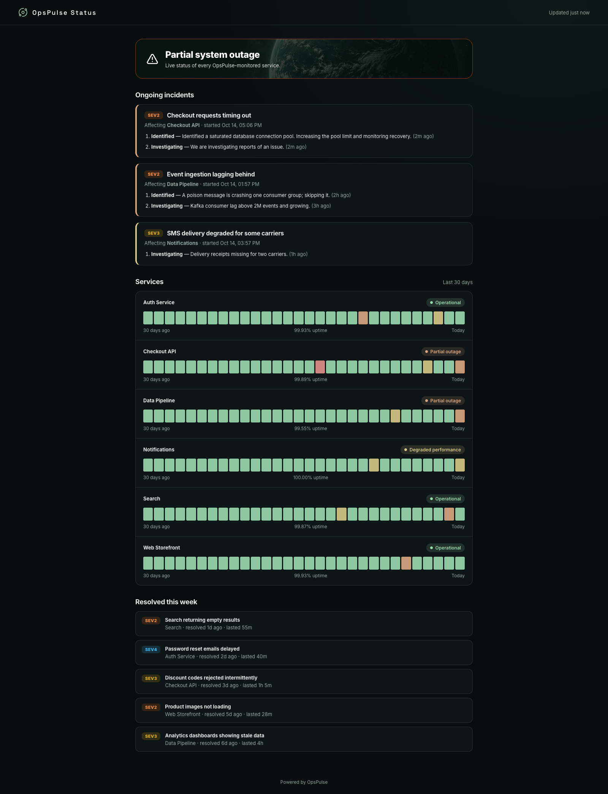

<details>
<summary><strong>🔎 A closer look at the uptime history</strong></summary>

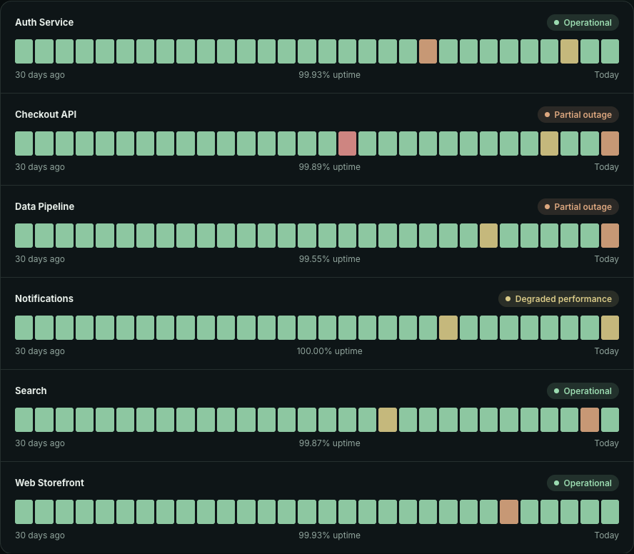

These percentages are calculated from recorded incidents. The seeded numbers illustrate the feature; they are not measurements of production availability.

</details>

### 07 · A little polish goes a long way

The interface supports light and dark modes, a responsive navigation layout, loading and error states, keyboard-accessible controls, and a footer that identifies the running environment and commit.

<table>
<tr>
<td width="75%" align="center"><strong>Light mode</strong><br>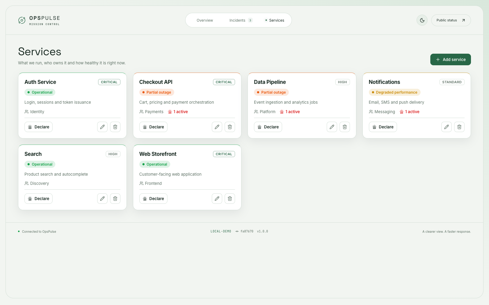</td>
<td width="25%" align="center"><strong>Mobile mission control</strong><br>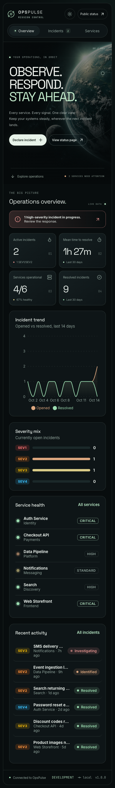</td>
</tr>
</table>

[Open the complete desktop overview →](docs/screenshots/overview-desktop.png)

## 🛰️ How the platform fits together

There are two related paths: **serving the application** and **delivering changes safely**.

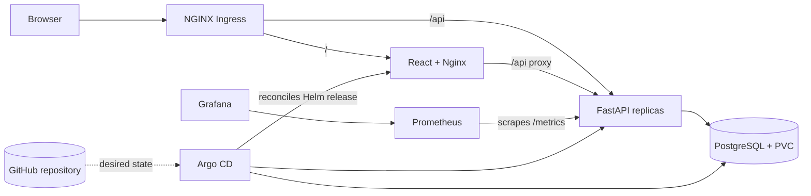

**Application path:** browser → Ingress/frontend proxy → FastAPI → PostgreSQL. The API exposes separate liveness and database-aware readiness endpoints.

**Platform path:** GitHub Actions validates the code and images, tests a Helm installation in a temporary kind cluster, then updates the GitOps image tags. Argo CD reconciles those tags in the development cluster.

**AWS path:** the short demo will use Terraform-provisioned EKS and a direct Helm release. It uses private port-forward access rather than a public Ingress. Argo CD remains part of the Codespaces walkthrough.

| Layer | Technology | Why it is here |
|---|---|---|
| Web interface | React 19, Vite, React Router, Recharts, Lucide | Responsive application screens, routing and operational charts |
| API | FastAPI, Pydantic, SQLAlchemy 2 | Validated requests, structured endpoints and relational persistence |
| Database | PostgreSQL 16, Alembic | Durable incident history and repeatable schema migrations |
| Containers | Docker, Docker Compose, Nginx | Reproducible builds and a simple local startup path |
| Orchestration | Kubernetes, Helm | Declarative deployment, health checks, scaling and storage |
| Delivery | GitHub Actions, GHCR, Argo CD | Tested images and Git-tracked release promotion |
| Observability | Prometheus, Grafana, JSON logs | Request metrics, business metrics, dashboards and investigation |
| Infrastructure | Terraform, AWS VPC, EKS | Reproducible infrastructure for the short cloud demo |

## 🚀 From a commit to a deployment

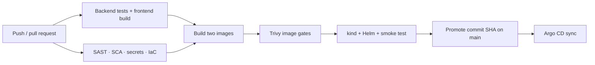

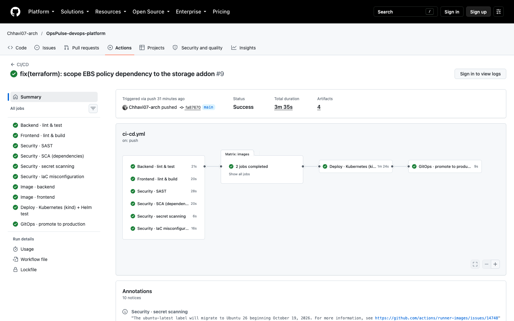

[Inspect the actual CI run and logs →](https://github.com/Chhavi07-arch/OpsPulse-devops-platform/actions/runs/38599535048)

The pipeline has **10 jobs**, including separate backend/frontend image jobs. Images use the full **Git commit SHA**, so a release points to a specific build rather than a moving `latest` tag. Pull requests run validation but do not publish images or promote a release.

| Gate | What it verifies |
|---|---|
| Backend | Ruff lint/format and pytest with coverage |
| Frontend | ESLint and a production Vite build |
| Source security | Bandit and Semgrep |
| Dependencies | pip-audit and npm audit |
| Secrets | Gitleaks across Git history |
| Infrastructure | Trivy configuration scanning |
| Images | Successful builds and no fixable HIGH/CRITICAL findings |
| Deployment | A real Helm installation in kind and in-cluster endpoint checks |
| Promotion | Updating the GitOps values only after the previous gates pass |

> **What the deployment test proves:** the chart can start its workloads and pass the smoke test in CI’s temporary kind cluster. It does not prove that the separate Codespace or AWS environment is currently running.

## 🛡️ Security at every layer

Build-time checks and runtime controls address different failure modes.

- **Before release:** scan source, dependencies, secrets, Kubernetes/Terraform configuration and both container images.
- **Inside containers:** run as non-root, drop Linux capabilities, use read-only root filesystems and `RuntimeDefault` seccomp.
- **Inside Kubernetes:** enforce restricted Pod Security and restrict PostgreSQL ingress to backend pods with NetworkPolicy.
- **For configuration:** keep credentials out of source control; use environment variables and a Kubernetes Secret.
- **For infrastructure:** restrict EKS API access to explicitly configured CIDRs; encrypt the demo database’s gp3 volume.

The [accepted-risk register](security/.trivyignore) records two EKS IaC exceptions. A passing scan is a result for a particular commit and vulnerability database—not a claim that software has no security risks. Image gates block fixable HIGH/CRITICAL findings; unfixed findings remain visible.

**Current boundary:** the app has no sign-in or role-based access control. Keep write APIs private for the demo. Author names in timelines are user-entered, not verified identities.

## ☸️ Kubernetes, storage and resilience

The Helm chart packages the application and its operational controls together.

| Resource | Behaviour |
|---|---|
| Deployments | Frontend and backend start with two replicas each |
| Startup/liveness/readiness probes | Separate process health from database availability |
| Init containers | Wait for PostgreSQL, then apply Alembic migrations |
| Migration locking | PostgreSQL advisory lock prevents concurrent migration races |
| StatefulSet + PVC | PostgreSQL stores data on a persistent volume |
| HPA | CPU target 70%; backend 2–6 replicas and frontend 2–4 |
| PodDisruptionBudget | Retain at least one frontend/backend replica during voluntary disruption |
| Helm test | Verify `/ready` and `/api/services` from inside the cluster |

[Chart templates](helm/opspulse/templates/) · [Default values](helm/opspulse/values.yaml) · [Kubernetes setup guide](docs/operations-guide.md#kubernetes-and-helm)

## 📡 Observability and GitOps

### Understand the system with Prometheus and Grafana

The API exposes request metrics and business metrics such as active incidents, declarations, resolutions and resolution duration. The chart includes a **ServiceMonitor**, **PrometheusRule alerts** and a provisioned **Grafana dashboard** when the Prometheus Operator is present.

The dashboard covers request rate, errors, p50/p95/p99 latency, HTTP status codes, active incidents by severity, and pod resources. Alerts cover an unavailable backend, elevated errors, high latency and an open SEV1 incident. JSON logs attach a request ID, route, status code and duration to each request.

[Monitoring configuration](monitoring/kube-prometheus-stack-values.yaml) · [Installation and access](docs/operations-guide.md#monitoring-and-logs)

### Keep desired state in Git with Argo CD

Argo CD reads the Helm chart and production image tags from the same repository through a multi-source Application. Auto-sync applies changes, self-heal reconciles drift, and prune removes resources deleted from Git.

The Application uses `ServerSideDiff=true`, added while investigating repeated StatefulSet differences. [Read the Application](gitops/argocd/application.yaml) and [GitOps setup](docs/operations-guide.md#gitops-with-argo-cd).

**Screenshot status:** live Grafana, Prometheus and Argo CD captures are still pending access to the running Codespace. Configuration is implemented; this README does not substitute mock dashboards for deployment evidence.

## ☁️ AWS demo: designed and ready to launch later

Terraform defines a VPC with two public and two private subnets across two availability zones, one NAT gateway, an EKS cluster, managed workers and the required add-ons. EBS CSI uses a dedicated Pod Identity role to provision encrypted database storage.

| Item | Demo plan |
|---|---|
| Existing project | Hello World |
| Workload Region | Sydney · `ap-southeast-2` |
| Kubernetes | EKS 1.35, verified in standard support |
| Workers | Two `t3.medium` instances, fixed node count of two |
| Browser access | Authenticated `kubectl port-forward` to localhost |
| Infrastructure state | Plan validated: **60 create, 0 change, 0 destroy** |
| Deployment state | **Not launched**; reserved for the presentation/demo session |
| Cost approach | Brief session, then workload and infrastructure teardown |

The compute/network base estimate is **$0.2696/hour**, excluding disks, KMS, logs, data processing/transfer, possible surplus CPU credits and taxes. Pricing was checked on 14 October 2026; the [operations guide](docs/operations-guide.md#short-aws-application-demo) has the breakdown and teardown sequence. It is an estimate, not an automatic spending cap.

AWS screenshots will be added after the actual demo. The infrastructure plan and local app screenshots should not be mistaken for a running AWS deployment.

## 🧑‍🚀 Launch locally

With Docker and Docker Compose installed:

```bash
git clone https://github.com/Chhavi07-arch/OpsPulse-devops-platform.git
cd OpsPulse-devops-platform/docker
cp .env.example .env
# Edit .env and set a strong POSTGRES_PASSWORD.
docker compose up --build
```

| Open | What you will see |
|---|---|
| [localhost:3000](http://localhost:3000) | Mission-control overview |
| [localhost:3000/incidents](http://localhost:3000/incidents) | Incident list |
| [localhost:3000/services](http://localhost:3000/services) | Service catalogue |
| [localhost:3000/status](http://localhost:3000/status) | Public status page |
| [localhost:8000/docs](http://localhost:8000/docs) | Interactive API documentation |
| [localhost:8000/metrics](http://localhost:8000/metrics) | Prometheus metrics |

For the complete platform on a machine with sufficient memory, follow the [Codespaces/minikube instructions](docs/operations-guide.md#kubernetes-and-helm). After resuming a configured Codespace, run `bash .devcontainer/demo-forward.sh` and keep that terminal open. A forwarded port alone does not mean the service behind it is running.

<details>
<summary><strong>🧪 Run the backend tests yourself</strong></summary>

```bash
cd application/backend
python -m venv .venv
source .venv/bin/activate
pip install -r requirements-dev.txt
pytest -v --cov=app
```

Tests use isolated SQLite data and cover service CRUD, incident lifecycle, validation, health endpoints, statistics and uptime edge cases. CI also runs frontend lint/build and the Kubernetes smoke test.

</details>

## 🔌 API and data model

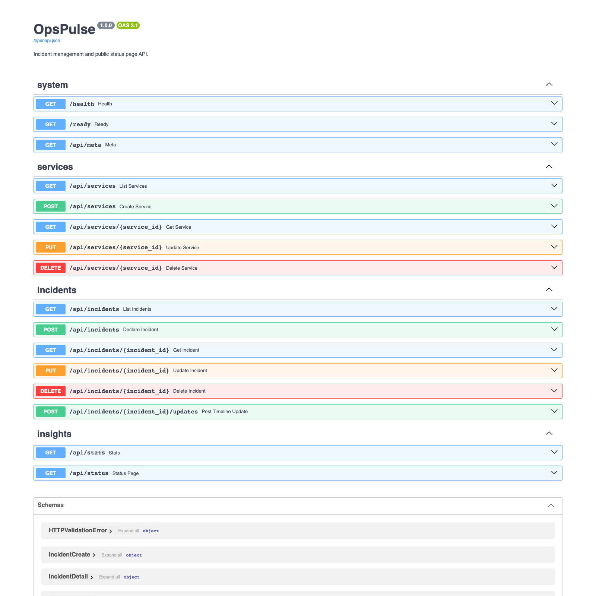

| Endpoint | Purpose |
|---|---|
| `GET /health` · `GET /ready` | Liveness and database-aware readiness |
| `GET /metrics` | Prometheus metrics |
| `GET /api/meta` | Version, environment and build SHA |
| `/api/services` · `/api/services/{id}` | List/create and read/update/delete services |
| `/api/incidents` · `/api/incidents/{id}` | Filter/create and read/update/delete incidents |
| `POST /api/incidents/{id}/updates` | Add a timeline entry and update incident status |
| `GET /api/stats` | Overview KPIs and trends |
| `GET /api/status` | Public service health and uptime history |

The data model has three core entities: **Service → Incident → IncidentUpdate**. A service can have many incidents; an incident can have many timeline entries. Validation belongs in the API as well as the interface.

## 🗂️ Repository map

```text
application/
  backend/               FastAPI, models, migrations and tests
  frontend/              React pages, reusable components and orbital theme
docker/                  Dockerfiles, Nginx and Compose
helm/opspulse/           Workloads, probes, HPA, storage and monitoring templates
kubernetes/              Namespace, AWS StorageClass and troubleshooting exercises
terraform/               VPC, EKS, managed workers and storage permissions
.github/workflows/       CI/CD and security gates
gitops/                  Argo CD Application, AppProject and production image tags
monitoring/              Prometheus/Grafana installation values
security/                Scan configuration and documented exceptions
docs/                    Operations guide, troubleshooting and screenshots
```

## 📸 Evidence and project status

| Area | Implemented / verified | Remaining evidence or work |
|---|---|---|
| Application | Local UI/API walkthrough and screenshots | User authentication and permissions |
| Backend tests | 30 passing, 97% coverage in cited CI run | Extend coverage as features grow |
| Delivery | All 10 CI jobs passed; kind install and Helm smoke test passed | Capture the next end-to-end live GitOps change |
| Kubernetes | Chart, scaling, probes, persistence and network policies | Fresh screenshots from the resumed development cluster |
| GitOps | Argo CD manifests and SHA promotion | Current Synced/Healthy screen |
| Observability | Metrics, dashboard and alert configuration | Live Grafana graphs and Prometheus targets |
| AWS | Authentication, regional preflight and Terraform plan verified | Provision, demonstrate, record evidence, then destroy |

Screenshot provenance and the remaining capture checklist are in [the screenshot index](docs/screenshots/README.md). No personal AWS billing details, credentials or access tokens are included in the public evidence.

## 🌱 Lessons and next steps

**Readiness is different from liveness.** A running process may still be unable to reach its database. Separate probes let Kubernetes route traffic correctly.

**Concurrent replicas need coordinated migrations.** An advisory lock protects the schema when init containers start together.

**Small infrastructure dependencies can stop a whole plan.** A module-wide EBS-policy dependency deferred identity lookups and broke Terraform resource counts. Narrowing the dependency to the storage add-on produced a successful full plan.

**Outage arithmetic matters.** Merging overlapping intervals avoids double-counting downtime; regression tests preserve that behaviour.

**Git is useful operational evidence.** SHA-tagged builds, gated promotion and an environment/commit footer make it possible to connect a running release to its source.

The next product steps are authentication/RBAC, notifications and external health checks. The next presentation steps are fresh cluster/monitoring evidence and the deliberately short AWS demonstration.

<details>
<summary><strong>🛠️ Troubleshooting lab: seven deliberate failures</strong></summary>

The [challenge script](kubernetes/troubleshooting/challenge.sh) can introduce an invalid image tag, wrong database password, Service selector typo, broken readiness probe, insufficient memory, unschedulable CPU request or incorrect Ingress backend.

Follow [the troubleshooting walkthrough](docs/troubleshooting.md) for symptoms, investigation, root cause, fix and verification. Run these exercises only in the disposable development environment.

</details>

---

<div align="center">

**Built by Chhavi Ahlawat** · [GitHub](https://github.com/Chhavi07-arch) · [MIT License](LICENSE)

*One platform. Total perspective.* 🪐

</div>
