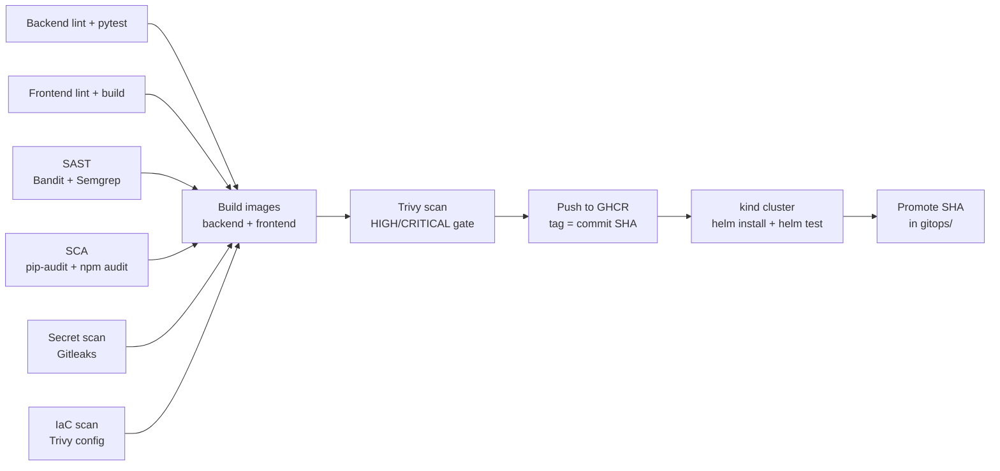

# OpsPulse · Operations guide

[← Back to the project](../README.md)

Detailed setup, recovery, security, monitoring and teardown instructions. For the product tour and verified evidence, start with the main README.

## Run locally with Docker Compose

```bash
cd docker
cp .env.example .env                      # then set POSTGRES_PASSWORD (openssl rand -hex 16)
docker compose up --build
```

| URL | What |
|---|---|
| http://localhost:3000 | OpsPulse dashboard |
| http://localhost:3000/status | Public status page |
| http://localhost:8000/docs | API documentation |
| http://localhost:8000/metrics | Prometheus metrics |

Both images run as non-root users (backend uid `10001`, frontend uid `101`), install OS security
updates at build time and define health checks. The frontend image is a multi-stage build
(Node build → Nginx runtime); Nginx proxies `/api` to the backend address given in `OPSPULSE_API_UPSTREAM`.

## Kubernetes and Helm

The chart in `helm/opspulse` deploys:

| Object | Details |
|---|---|
| Deployments | backend and frontend, ≥2 replicas, hardened security contexts, read-only root filesystems |
| Init containers | `wait-for-db`, then `migrate` (Alembic, protected by a Postgres advisory lock) |
| Probes | startup + liveness on `/health`, readiness on `/ready` (database check) |
| Services | ClusterIP for backend (8000) and frontend (8080), headless for Postgres |
| Ingress | `opspulse.local`: `/api` → backend, `/` → frontend |
| ConfigMap / Secret | non-secret settings / database password (or an existing Secret) |
| StatefulSet + PVC | PostgreSQL with a 1 Gi volume claim |
| HPA | backend 2–6 and frontend 2–4 replicas at 70% CPU |
| PodDisruptionBudget | keeps at least one replica of each during node maintenance |
| NetworkPolicy | only backend pods may reach PostgreSQL |
| ServiceMonitor, PrometheusRule, dashboard ConfigMap | rendered when the Prometheus Operator is installed |
| Helm test | calls `/ready` and `/api/services` from inside the cluster |

**Deploy to minikube:**

```bash
minikube start --memory=3800 --cpus=4
minikube addons enable ingress
minikube addons enable metrics-server

# build the images on the laptop and load them into the cluster
docker build -t opspulse-backend:local  --build-arg GIT_SHA=$(git rev-parse HEAD) -f docker/backend/Dockerfile .
docker build -t opspulse-frontend:local -f docker/frontend/Dockerfile .
minikube image load opspulse-backend:local
minikube image load opspulse-frontend:local

kubectl apply -f kubernetes/namespace.yaml
helm upgrade --install opspulse helm/opspulse -n opspulse \
  -f helm/opspulse/values-local.yaml \
  --set postgresql.auth.password="$(openssl rand -hex 16)" --wait
helm test opspulse -n opspulse

kubectl get pods,svc,ingress,hpa,pvc -n opspulse
helm list -n opspulse
```

Open it through the Ingress: run `minikube tunnel` in another terminal, add `127.0.0.1 opspulse.local`
to `/etc/hosts`, then browse to http://opspulse.local.

**Full demo in GitHub Codespaces:** the whole platform (app, Argo CD, Prometheus, Grafana) needs about
12 GB of memory. On a smaller laptop, open the repository in a Codespace (**Code → Codespaces → Create**,
4-core machine) and run `.devcontainer/demo-up.sh`. It builds the cluster, lets Argo CD deploy OpsPulse
from Git and forwards every UI to the **Ports** tab.

After resuming an existing Codespace, the Ports tab can retain links even when the processes behind
them have stopped. First check `kubectl config get-contexts` to identify the existing cluster.
For minikube, check `minikube profile list` and `minikube status`; resume an existing stopped profile
with `minikube -p PROFILE_NAME start`, or repair its connection with `minikube -p PROFILE_NAME update-context`.
For an existing kind cluster whose context is missing, use `kind get clusters`, then
`kind export kubeconfig --name CLUSTER_NAME`. Do not create a second cluster to repair a missing context.
Then run `bash .devcontainer/demo-forward.sh` and leave that terminal open. It checks the application
deployments, restores the four UI forwards, verifies HTTP responses and reports a failed forward.
It uses the current Kubernetes context, or `OPSPULSE_KUBE_CONTEXT` when explicitly set. If there is no
current context, it can restore a running default minikube profile; otherwise it prints recovery steps.
Port 8443 uses HTTPS; the other three ports use HTTP inside the Codespace. The generated external
Codespaces URLs still use HTTPS. Run the full setup script only when the stack needs installation.

The Codespaces setup completed on 7 October 2026: Argo CD reported **Synced/Healthy**, all five
application pods were Ready with zero restarts, both HPAs reported CPU metrics, and the PostgreSQL
1 Gi PVC was Bound. Screenshots and verification of live monitoring data are still pending.

## Terraform: AWS VPC + EKS

`terraform/` provisions a VPC with **two public and two private subnets** across two availability zones
(single NAT gateway), and an **EKS cluster** with a managed node group in the private subnets. The
Kubernetes API is reachable only from the CIDRs in `cluster_endpoint_public_access_cidrs`; a validation
rule rejects `0.0.0.0/0`. All resources carry `Project`, `Owner` and `ManagedBy` tags.

```bash
cd terraform
cp terraform.tfvars.example terraform.tfvars    # set owner and your IP/32
terraform init
terraform plan
terraform apply                                  # ~15 minutes
$(terraform output -raw configure_kubectl)       # point kubectl at EKS
terraform destroy                                # always, after the demo
```

Credentials come from the AWS CLI profile; `terraform.tfvars` and state files are gitignored.
**Demo cost:** EKS standard support costs $0.10 per cluster-hour; worker instances, NAT gateway,
public IPv4, EBS and data transfer are additional. Check the selected region and instance sizes in the
[AWS Pricing Calculator](https://calculator.aws/) before applying; $0.19/hour is not an all-inclusive
budget. Check credit eligibility and expiry in **Billing → Credits**. Credits offset eligible charges;
they do not stop running resources when the demo ends. See [EKS pricing](https://aws.amazon.com/eks/pricing/).

### Short AWS application demo

Keep development and the GitOps walkthrough in Codespaces; create AWS resources only for the demo.

For an AWS **Projects** account, first open **Settings → Projects → Additional info** and check the
project's assigned region. Use that region for login and Terraform (for example, Sydney is
`ap-southeast-2`). The region shown in a billing page URL is not the workload region. Console home
also provides **Connect your AI-coding agent to AWS → Copy agent prompt** for project-specific setup.
See [AWS project connection instructions](https://docs.aws.amazon.com/accounts/latest/reference/connect-ai-coding-tool.html).

Run these in the same terminal on the machine that will run Terraform; replace the region if your
project uses another one. Finish the browser sign-in and wait for login to succeed before continuing:

```bash
aws configure set region ap-southeast-2 --profile opspulse-login
aws login --profile opspulse-login --region ap-southeast-2
aws sts get-caller-identity --profile opspulse-login
```

If the browser shows a sign-in error, start a fresh login and choose the same identity and project
used in AWS Settings. Cancelling the command does not establish credentials. Do not continue while
the identity check fails. For Terraform clients that do not consume the login cache directly, use
the AWS CLI credential process bridge after successful login:

```bash
aws configure set credential_process 'aws configure export-credentials --profile opspulse-login --format process' --profile opspulse-demo
aws configure set region ap-southeast-2 --profile opspulse-demo
export AWS_PROFILE=opspulse-demo
aws sts get-caller-identity
```

These commands configure profiles under `~/.aws/`, outside this repository. Do not copy credentials
into source files, Terraform variables or GitHub. Renew expired sessions with `aws login --profile
opspulse-login --region ap-southeast-2`. See [AWS CLI sign-in](https://docs.aws.amazon.com/cli/latest/userguide/cli-configure-sign-in.html).

Terraform also installs metrics-server (for HPAs), enables VPC CNI NetworkPolicy enforcement and
installs the EBS CSI driver with a dedicated Pod Identity role. The driver provisions PostgreSQL's
encrypted gp3 volume. See [AWS EBS CSI setup](https://docs.aws.amazon.com/eks/latest/userguide/ebs-csi.html).

Before `terraform plan`, confirm `aws sts get-caller-identity` succeeds. Set `region`, `owner` and
your current public IP/32 in `terraform/terraform.tfvars`. For the complete monitoring/GitOps stack,
use the larger node settings in `terraform.tfvars.example`; two `t3.small` nodes have limited memory
and pod capacity. Keep the local Terraform state until teardown is complete.

Check the plan and credit balance before creating resources:

```bash
aws freetier get-account-plan-state --profile opspulse-login --region ap-southeast-2
```

For the new AWS experience, also open **AWS Settings → Billing** to confirm the remaining credits,
their expiry and eligible services, and any spend limit. The API's `accountPlanRemainingCredits`
field is the plan credit balance; do not assume it includes every promotional credit shown in
AWS Settings. Resolve a discrepancy before relying on credits to cover the demo.

An app-only demo can use two `t3.medium` workers with minimum, desired and maximum size all set
to `2`. Sydney list prices checked on 2026-10-14 give a **$0.2696/hour base**: EKS standard support
($0.10), two workers ($0.1056), one NAT gateway ($0.059), and its public IPv4 address ($0.005).
This excludes EBS storage, KMS, CloudWatch logs, NAT data processing, data transfer, possible T3
surplus CPU credits and taxes. These are usage estimates, not a spending cap. Rates came from
the AWS Price List API and [EKS pricing](https://aws.amazon.com/eks/pricing/); recheck them before
the demo. Keep monitoring and Argo CD in Codespaces for this smaller AWS configuration.

After applying Terraform and running its `configure_kubectl` output, run from the repository root:

```bash
kubectl config current-context                       # confirm this is the demo EKS cluster
kubectl get nodes
kubectl apply -f kubernetes/namespace.yaml -f kubernetes/aws/storageclass.yaml
# Run once on the new cluster. Never replace this password while retaining its database volume.
kubectl create secret generic opspulse-db -n opspulse \
  --from-literal=postgres-password="$(openssl rand -hex 16)"

helm upgrade --install opspulse helm/opspulse -n opspulse \
  -f gitops/environments/production/values.yaml \
  -f helm/opspulse/values-aws-demo.yaml --wait --timeout 10m
helm test opspulse -n opspulse --logs
kubectl get pods,svc,hpa,pvc -n opspulse
kubectl port-forward -n opspulse svc/opspulse-frontend 3000:8080
```

While the forward runs, open **http://localhost:3000** and **http://localhost:3000/status**.
The workload runs on AWS; the browser reaches it through the authenticated Kubernetes connection.
This demo override disables Ingress, so it does not create a public website or a load balancer.
Ingress evidence comes from the Codespaces deployment. The app has no authentication, so public
hosting needs access control before exposing its write API. API docs are available with a separate
`kubectl port-forward -n opspulse svc/opspulse-backend 8000:8000` at http://localhost:8000/docs.

This AWS path uses Helm directly. Argo CD continues to own the Codespaces app; do not point it at
the same AWS release without explicitly transferring ownership and adding the AWS values override.
For AWS monitoring, install the monitoring chart as described below, then rerun the app's Helm upgrade.

After recording the demo, remove the workload and its **disposable demo database** before destroying
the cluster, so the EBS driver can delete its volume:

```bash
kubectl config current-context                       # confirm the demo EKS cluster again
kubectl get pv                                      # record the demo volume ID
helm uninstall opspulse -n opspulse --wait
kubectl delete pvc data-opspulse-postgres-0 -n opspulse
kubectl get pv                                      # wait for that PV to disappear
terraform -chdir=terraform plan -destroy
terraform -chdir=terraform destroy
terraform -chdir=terraform state list                # should be empty after successful destroy
```

Verify the demo EBS volume is deleted in EC2, and confirm no demo load balancers, NAT gateways,
Elastic IPs or instances remain. EBS volumes created by Kubernetes are outside Terraform's state.

## CI/CD pipeline

`.github/workflows/ci-cd.yml` runs on every push and pull request to `main`:



| Stage | What fails the build |
|---|---|
| Backend | Ruff lint/format errors, any failing pytest case |
| Frontend | ESLint errors, build errors |
| Security | see [DevSecOps](#devsecops) |
| Images | Dockerfile build errors, fixable HIGH/CRITICAL vulnerabilities |
| Deploy | pods not Ready within 6 minutes, failing `helm test` |

Images are tagged with the full commit SHA (never `latest`), so every running pod can be traced back
to the exact commit. Pull requests run every check but do not push images or deploy.

## DevSecOps

Security runs as parallel jobs; the images are only built if **all** of them pass.

| Layer | Tool | Scope | Gate |
|---|---|---|---|
| SAST | Bandit | Python source | medium+ severity and confidence |
| SAST | Semgrep (`p/default`) | Python, JavaScript, Dockerfiles, YAML | ERROR findings |
| SCA | pip-audit | backend dependencies | any known vulnerability |
| SCA | npm audit | frontend runtime dependencies | high+ |
| Secrets | Gitleaks | the full Git history | any secret |
| IaC | Trivy config | Helm chart, Kubernetes, Terraform, Dockerfiles | HIGH/CRITICAL |
| Containers | Trivy image | both images (OS packages + libraries) | fixable HIGH/CRITICAL |

Trivy results are also uploaded to **GitHub code scanning** (Security tab).

**What Trivy scans and what the result means:** Trivy inventories every OS package in the image (Debian
for the backend, Alpine for the frontend) and every application library, and matches their versions
against vulnerability databases. A clean result means no HIGH or CRITICAL vulnerability with an
available fix is present, because the Dockerfiles apply OS security updates and the dependencies are
current; unfixed findings are reported but do not block, since nothing can be upgraded yet.

The IaC scan found a real issue during development (PostgreSQL without a read-only root filesystem),
which was fixed. Two findings in the EKS module are accepted with written justifications in
[`security/.trivyignore`](../security/.trivyignore). Run every gate locally with `security/run-local-scans.sh`.

Runtime hardening: non-root containers, read-only root filesystems, all Linux capabilities dropped,
`RuntimeDefault` seccomp, the namespace enforces the **restricted** Pod Security Standard, and a
NetworkPolicy isolates the database.

## Monitoring and logs

```bash
helm repo add prometheus-community https://prometheus-community.github.io/helm-charts
helm upgrade --install monitoring prometheus-community/kube-prometheus-stack \
  -n monitoring --create-namespace -f monitoring/kube-prometheus-stack-values.yaml
# re-deploy OpsPulse so the ServiceMonitor, alerts and dashboard are created
```

- **Metrics:** `/metrics` exposes HTTP request rate/latency/status plus business metrics
  (`opspulse_active_incidents`, `opspulse_incidents_declared_total`, `opspulse_incidents_resolved_total`,
  `opspulse_incident_resolution_seconds`). A ServiceMonitor makes Prometheus scrape every backend pod.
- **Dashboard:** "OpsPulse — Service Overview" is provisioned automatically: request rate, error rate,
  p50/p95/p99 latency, status codes, active incidents by severity, CPU and memory per pod.
- **Alerts** (PrometheusRule): backend down, error rate above 5%, p95 latency above 1s, SEV1 open.
- **Logs:** one JSON object per line with request ID, method, path, status and duration, e.g.
  `kubectl logs -n opspulse deploy/opspulse-backend | grep '"status": 5'`.

```bash
kubectl port-forward -n monitoring svc/monitoring-kube-prometheus-prometheus 9090   # Prometheus
kubectl port-forward -n monitoring svc/monitoring-grafana 3001:80                     # Grafana
kubectl get secret -n monitoring monitoring-grafana -o jsonpath='{.data.admin-password}' | base64 -d
```

## GitOps with Argo CD

Git is the source of truth for what runs in the cluster. The chart lives in `helm/opspulse`; the
environment-specific values (image tags) live in `gitops/environments/production/values.yaml`, which the
pipeline updates after the images pass every gate. Argo CD watches the repository and reconciles the
cluster; `selfHeal` reverts manual changes and `prune` removes resources deleted from Git.

The Application enables `ServerSideDiff=true` so Argo CD compares the live resources with the state
predicted by Kubernetes. This resolved a repeated `OutOfSync/Healthy` condition on the PostgreSQL
StatefulSet during the Codespaces demo, even though each sync operation succeeded.

```bash
kubectl apply -f kubernetes/namespace.yaml
kubectl create secret generic opspulse-db -n opspulse \
  --from-literal=postgres-password="$(openssl rand -hex 16)"     # once; never stored in Git
kubectl apply -f gitops/argocd/project.yaml -f gitops/argocd/application.yaml
```

**Live demo:** change the UI → `git push` → the pipeline builds, scans and promotes the new SHA → Argo CD
syncs → the application footer shows the new commit.

## Troubleshooting challenge

`kubernetes/troubleshooting/challenge.sh` deliberately breaks the running release in seven ways:
bad image tag, wrong database password, Service selector typo, broken readiness probe, memory limit too
low, unschedulable CPU request and a wrong Ingress backend. Each one is documented in
[`docs/troubleshooting.md`](troubleshooting.md): symptom, investigation, root cause, fix and verification.

```bash
kubernetes/troubleshooting/challenge.sh list
kubernetes/troubleshooting/challenge.sh break 3
kubernetes/troubleshooting/challenge.sh fix 3
```

